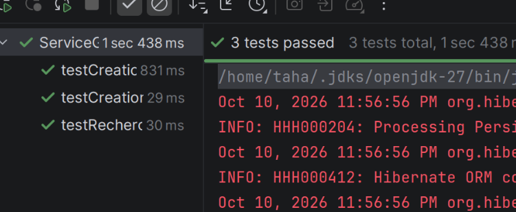

```console
/home/taha/.jdks/openjdk-27/bin/java -javaagent:/home/taha/.local/share/JetBrains/Toolbox/apps/intellij-idea/plugins/java/lib/rt/debugger-agent.jar=file:///tmp/capture10536308899062624384.props -ea -Didea.test.cyclic.buffer.size=1048576 -javaagent:/home/taha/.local/share/JetBrains/Toolbox/apps/intellij-idea/lib/idea_rt.jar=40407 -Dkotlinx.coroutines.debug.enable.creation.stack.trace=false -Ddebugger.agent.enable.coroutines=true -Dkotlinx.coroutines.debug.enable.flows.stack.trace=true -Dkotlinx.coroutines.debug.enable.mutable.state.flows.stack.trace=true -Ddebugger.async.stack.trace.for.all.threads=true -Ddebugger.agent.enable.log.capture=true -Dfile.encoding=UTF-8 -Dsun.stdout.encoding=UTF-8 -Dsun.stderr.encoding=UTF-8 -classpath /home/taha/.local/share/JetBrains/Toolbox/apps/intellij-idea/lib/idea_rt.jar:/home/taha/.local/share/JetBrains/Toolbox/apps/intellij-idea/plugins/junit/lib/junit5-rt.jar:/home/taha/.local/share/JetBrains/Toolbox/apps/intellij-idea/plugins/junit/lib/junit-rt.jar:/home/taha/college/s1.27/JEE/hibernate_tp2/target/test-classes:/home/taha/college/s1.27/JEE/hibernate_tp2/target/classes:/home/taha/.m2/repository/org/hibernate/hibernate-entitymanager/5.6.15.Final/hibernate-entitymanager-5.6.15.Final.jar:/home/taha/.m2/repository/org/jboss/logging/jboss-logging/3.4.3.Final/jboss-logging-3.4.3.Final.jar:/home/taha/.m2/repository/org/hibernate/hibernate-core/5.6.15.Final/hibernate-core-5.6.15.Final.jar:/home/taha/.m2/repository/antlr/antlr/2.7.7/antlr-2.7.7.jar:/home/taha/.m2/repository/org/jboss/jandex/2.4.2.Final/jandex-2.4.2.Final.jar:/home/taha/.m2/repository/com/fasterxml/classmate/1.5.1/classmate-1.5.1.jar:/home/taha/.m2/repository/javax/activation/javax.activation-api/1.2.0/javax.activation-api-1.2.0.jar:/home/taha/.m2/repository/javax/xml/bind/jaxb-api/2.3.1/jaxb-api-2.3.1.jar:/home/taha/.m2/repository/org/glassfish/jaxb/jaxb-runtime/2.3.1/jaxb-runtime-2.3.1.jar:/home/taha/.m2/repository/org/glassfish/jaxb/txw2/2.3.1/txw2-2.3.1.jar:/home/taha/.m2/repository/com/sun/istack/istack-commons-runtime/3.0.7/istack-commons-runtime-3.0.7.jar:/home/taha/.m2/repository/org/jvnet/staxex/stax-ex/1.8/stax-ex-1.8.jar:/home/taha/.m2/repository/com/sun/xml/fastinfoset/FastInfoset/1.2.15/FastInfoset-1.2.15.jar:/home/taha/.m2/repository/org/hibernate/common/hibernate-commons-annotations/5.1.2.Final/hibernate-commons-annotations-5.1.2.Final.jar:/home/taha/.m2/repository/net/bytebuddy/byte-buddy/1.12.18/byte-buddy-1.12.18.jar:/home/taha/.m2/repository/org/jboss/spec/javax/transaction/jboss-transaction-api_1.2_spec/1.1.1.Final/jboss-transaction-api_1.2_spec-1.1.1.Final.jar:/home/taha/.m2/repository/com/h2database/h2/2.1.214/h2-2.1.214.jar:/home/taha/.m2/repository/javax/persistence/javax.persistence-api/2.2/javax.persistence-api-2.2.jar:/home/taha/.m2/repository/junit/junit/4.13.2/junit-4.13.2.jar:/home/taha/.m2/repository/org/hamcrest/hamcrest-core/1.3/hamcrest-core-1.3.jar com.intellij.rt.junit.JUnitStarter -ideVersion5 -junit4 org.example.ServiceGestionTest
Oct 11, 2026 12:02:43 AM org.hibernate.jpa.internal.util.LogHelper logPersistenceUnitInformation
INFO: HHH000204: Processing PersistenceUnitInfo [name: hibernate_tp2]
Oct 11, 2026 12:02:43 AM org.hibernate.Version logVersion
INFO: HHH000412: Hibernate ORM core version 5.6.15.Final
Oct 11, 2026 12:02:43 AM org.hibernate.annotations.common.reflection.java.JavaReflectionManager <clinit>
INFO: HCANN000001: Hibernate Commons Annotations {5.1.2.Final}
Oct 11, 2026 12:02:43 AM org.hibernate.engine.jdbc.connections.internal.DriverManagerConnectionProviderImpl configure
WARN: HHH10001002: Using Hibernate built-in connection pool (not for production use!)
Oct 11, 2026 12:02:43 AM org.hibernate.engine.jdbc.connections.internal.DriverManagerConnectionProviderImpl buildCreator
INFO: HHH10001005: using driver [org.h2.Driver] at URL [jdbc:h2:mem:testdb;DB_CLOSE_DELAY=-1]
Oct 11, 2026 12:02:43 AM org.hibernate.engine.jdbc.connections.internal.DriverManagerConnectionProviderImpl buildCreator
INFO: HHH10001001: Connection properties: {user=sa, password=****}
Oct 11, 2026 12:02:43 AM org.hibernate.engine.jdbc.connections.internal.DriverManagerConnectionProviderImpl buildCreator
INFO: HHH10001003: Autocommit mode: false
Oct 11, 2026 12:02:43 AM org.hibernate.engine.jdbc.connections.internal.DriverManagerConnectionProviderImpl$PooledConnections <init>
INFO: HHH000115: Hibernate connection pool size: 20 (min=1)
Oct 11, 2026 12:02:43 AM org.hibernate.dialect.Dialect <init>
INFO: HHH000400: Using dialect: org.hibernate.dialect.H2Dialect
Oct 11, 2026 12:02:44 AM org.hibernate.resource.transaction.backend.jdbc.internal.DdlTransactionIsolatorNonJtaImpl getIsolatedConnection
INFO: HHH10001501: Connection obtained from JdbcConnectionAccess [org.hibernate.engine.jdbc.env.internal.JdbcEnvironmentInitiator$ConnectionProviderJdbcConnectionAccess@12eedfee] for (non-JTA) DDL execution was not in auto-commit mode; the Connection 'local transaction' will be committed and the Connection will be set into auto-commit mode.
Hibernate:

    create table Salle (
       id bigint generated by default as identity,
        capacite integer not null,
        nom varchar(255) not null,
        primary key (id)
    )
Hibernate:

    create table users (
       id bigint generated by default as identity,
        email varchar(255) not null,
        nom varchar(255) not null,
        salle_id bigint,
        primary key (id)
    )
Hibernate:

    alter table Salle 
       drop constraint if exists UK_drwtvi5w2jjlmbdwq0owvy4vm
Hibernate:

    alter table Salle 
       add constraint UK_drwtvi5w2jjlmbdwq0owvy4vm unique (nom)
Hibernate:

    alter table users 
       drop constraint if exists UK_6dotkott2kjsp8vw4d0m25fb7
Hibernate:

    alter table users 
       add constraint UK_6dotkott2kjsp8vw4d0m25fb7 unique (email)
Hibernate:

    alter table users 
       add constraint FK2etiad3llcrvam5dlhiv3ytra 
       foreign key (salle_id) 
       references Salle
Oct 11, 2026 12:02:44 AM org.hibernate.engine.transaction.jta.platform.internal.JtaPlatformInitiator initiateService
INFO: HHH000490: Using JtaPlatform implementation: [org.hibernate.engine.transaction.jta.platform.internal.NoJtaPlatform]
Hibernate:
insert
into
Salle
(id, capacite, nom)
values
(default, ?, ?)
Hibernate:
select
salle0_.id as id1_0_,
salle0_.capacite as capacite2_0_,
salle0_.nom as nom3_0_
from
Salle salle0_
Oct 11, 2026 12:02:44 AM org.hibernate.engine.jdbc.connections.internal.DriverManagerConnectionProviderImpl$PoolState stop
INFO: HHH10001008: Cleaning up connection pool [jdbc:h2:mem:testdb;DB_CLOSE_DELAY=-1]
Oct 11, 2026 12:02:44 AM org.hibernate.jpa.internal.util.LogHelper logPersistenceUnitInformation
INFO: HHH000204: Processing PersistenceUnitInfo [name: hibernate_tp2]
Oct 11, 2026 12:02:44 AM org.hibernate.engine.jdbc.connections.internal.DriverManagerConnectionProviderImpl configure
WARN: HHH10001002: Using Hibernate built-in connection pool (not for production use!)
Oct 11, 2026 12:02:44 AM org.hibernate.engine.jdbc.connections.internal.DriverManagerConnectionProviderImpl buildCreator
INFO: HHH10001005: using driver [org.h2.Driver] at URL [jdbc:h2:mem:testdb;DB_CLOSE_DELAY=-1]
Oct 11, 2026 12:02:44 AM org.hibernate.engine.jdbc.connections.internal.DriverManagerConnectionProviderImpl buildCreator
INFO: HHH10001001: Connection properties: {user=sa, password=****}
Oct 11, 2026 12:02:44 AM org.hibernate.engine.jdbc.connections.internal.DriverManagerConnectionProviderImpl buildCreator
INFO: HHH10001003: Autocommit mode: false
Oct 11, 2026 12:02:44 AM org.hibernate.engine.jdbc.connections.internal.DriverManagerConnectionProviderImpl$PooledConnections <init>
INFO: HHH000115: Hibernate connection pool size: 20 (min=1)
Oct 11, 2026 12:02:44 AM org.hibernate.dialect.Dialect <init>
INFO: HHH000400: Using dialect: org.hibernate.dialect.H2Dialect
Oct 11, 2026 12:02:44 AM org.hibernate.resource.transaction.backend.jdbc.internal.DdlTransactionIsolatorNonJtaImpl getIsolatedConnection
INFO: HHH10001501: Connection obtained from JdbcConnectionAccess [org.hibernate.engine.jdbc.env.internal.JdbcEnvironmentInitiator$ConnectionProviderJdbcConnectionAccess@30c3ae63] for (non-JTA) DDL execution was not in auto-commit mode; the Connection 'local transaction' will be committed and the Connection will be set into auto-commit mode.
Oct 11, 2026 12:02:44 AM org.hibernate.engine.transaction.jta.platform.internal.JtaPlatformInitiator initiateService
INFO: HHH000490: Using JtaPlatform implementation: [org.hibernate.engine.transaction.jta.platform.internal.NoJtaPlatform]
Hibernate:
insert
into
Salle
(id, capacite, nom)
values
(default, ?, ?)
Hibernate:
insert
into
users
(id, email, nom, salle_id)
values
(default, ?, ?, ?)
Hibernate:
select
user0_.id as id1_1_,
user0_.email as email2_1_,
user0_.nom as nom3_1_,
user0_.salle_id as salle_id4_1_
from
users user0_
Oct 11, 2026 12:02:44 AM org.hibernate.engine.jdbc.connections.internal.DriverManagerConnectionProviderImpl$PoolState stop
INFO: HHH10001008: Cleaning up connection pool [jdbc:h2:mem:testdb;DB_CLOSE_DELAY=-1]
Oct 11, 2026 12:02:44 AM org.hibernate.jpa.internal.util.LogHelper logPersistenceUnitInformation
INFO: HHH000204: Processing PersistenceUnitInfo [name: hibernate_tp2]
Oct 11, 2026 12:02:44 AM org.hibernate.engine.jdbc.connections.internal.DriverManagerConnectionProviderImpl configure
WARN: HHH10001002: Using Hibernate built-in connection pool (not for production use!)
Oct 11, 2026 12:02:44 AM org.hibernate.engine.jdbc.connections.internal.DriverManagerConnectionProviderImpl buildCreator
INFO: HHH10001005: using driver [org.h2.Driver] at URL [jdbc:h2:mem:testdb;DB_CLOSE_DELAY=-1]
Oct 11, 2026 12:02:44 AM org.hibernate.engine.jdbc.connections.internal.DriverManagerConnectionProviderImpl buildCreator
INFO: HHH10001001: Connection properties: {user=sa, password=****}
Oct 11, 2026 12:02:44 AM org.hibernate.engine.jdbc.connections.internal.DriverManagerConnectionProviderImpl buildCreator
INFO: HHH10001003: Autocommit mode: false
Oct 11, 2026 12:02:44 AM org.hibernate.engine.jdbc.connections.internal.DriverManagerConnectionProviderImpl$PooledConnections <init>
INFO: HHH000115: Hibernate connection pool size: 20 (min=1)
Oct 11, 2026 12:02:44 AM org.hibernate.dialect.Dialect <init>
INFO: HHH000400: Using dialect: org.hibernate.dialect.H2Dialect
Oct 11, 2026 12:02:44 AM org.hibernate.resource.transaction.backend.jdbc.internal.DdlTransactionIsolatorNonJtaImpl getIsolatedConnection
INFO: HHH10001501: Connection obtained from JdbcConnectionAccess [org.hibernate.engine.jdbc.env.internal.JdbcEnvironmentInitiator$ConnectionProviderJdbcConnectionAccess@65f40689] for (non-JTA) DDL execution was not in auto-commit mode; the Connection 'local transaction' will be committed and the Connection will be set into auto-commit mode.
Oct 11, 2026 12:02:44 AM org.hibernate.engine.transaction.jta.platform.internal.JtaPlatformInitiator initiateService
INFO: HHH000490: Using JtaPlatform implementation: [org.hibernate.engine.transaction.jta.platform.internal.NoJtaPlatform]
Hibernate:
insert
into
Salle
(id, capacite, nom)
values
(default, ?, ?)
Hibernate:
insert
into
users
(id, email, nom, salle_id)
values
(default, ?, ?, ?)
Hibernate:
insert
into
users
(id, email, nom, salle_id)
values
(default, ?, ?, ?)
Hibernate:
select
user0_.id as id1_1_,
user0_.email as email2_1_,
user0_.nom as nom3_1_,
user0_.salle_id as salle_id4_1_
from
users user0_ cross
join
Salle salle1_
where
user0_.salle_id=salle1_.id
and salle1_.nom=?
Oct 11, 2026 12:02:44 AM org.hibernate.engine.jdbc.connections.internal.DriverManagerConnectionProviderImpl$PoolState stop
INFO: HHH10001008: Cleaning up connection pool [jdbc:h2:mem:testdb;DB_CLOSE_DELAY=-1]

Process finished with exit code 0

```



